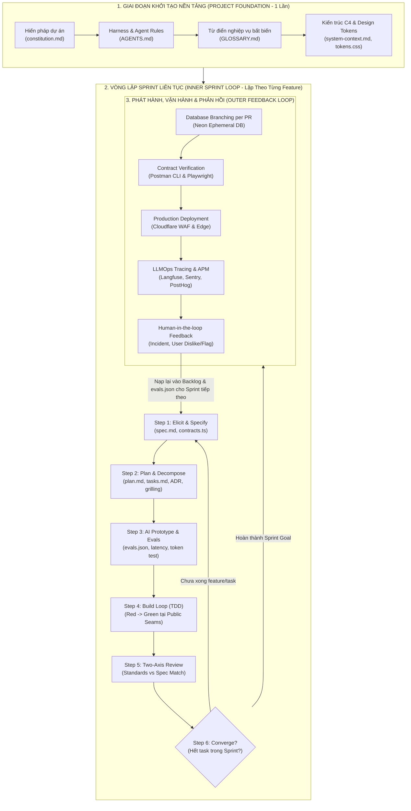

# Kế hoạch Quy Trình Vòng Đời Phần Mềm Thời AI (Dual-Loop AI-Native SDLC)

## 1. Tóm tắt Mục tiêu
Cập nhật và tái cấu trúc toàn diện tài liệu kỹ thuật cùng trang tương tác trực quan theo mô hình chuẩn **Dual-Loop AI-Native SDLC**:
1. **Giai đoạn Khởi Tạo Nền Tảng (Project Foundation / Inception)**: Làm một lần ở đầu dự án để thiết lập Hiến pháp (`constitution.md`), Harness (`AGENTS.md`), Từ điển nghiệp vụ (`GLOSSARY.md`), Kiến trúc C4 và Design Tokens.
2. **Vòng lặp Sprint Liên Tục (The Inner Sprint Loop: Specify ➔ Plan ➔ Prototype ➔ TDD Build ➔ Review ➔ Converge)**: Lặp đi lặp lại liên tục cho từng feature / user story cho tới khi hoàn thành mục tiêu sprint.
3. **Vòng lặp Phát Hành & Vận Hành Khép Kín (The Outer Release & Feedback Loop)**: Triển khai kiểm thử trên nhánh Database tạm thời (Neon), giám sát LLMOps (Langfuse), và nạp phản hồi người dùng ngược lại vào backlog / evals của sprint tiếp theo.

## 2. Danh sách Tệp Tạo & Cập Nhật
- [`/.agents/plans/plan-ai-system-engineering-workflow.md`](/.agents/plans/plan-ai-system-engineering-workflow.md): Kế hoạch thực thi chuẩn Yuiyui.
- [`/docs/ai-engineering-guide.md`](/docs/ai-engineering-guide.md): Tài liệu hướng dẫn toàn diện chi tiết 3 khối: Foundation ➔ Sprint Loop ➔ Outer Feedback Loop.
- [`/docs/workflow-guide.html`](/docs/workflow-guide.html): Dashboard tương tác với sơ đồ luồng Dual-Loop trực quan, các tab so sánh, ma trận công cụ và modal chi tiết.

## 3. Sơ Đồ Kiến Trúc Quy Trình Dual-Loop

## 4. Danh sách Công việc (Todo List)
- [x] Soát xét và nghiên cứu thực nghiệm mô hình Dual-Loop (Inner Sprint Loop vs Outer Release Loop).
- [x] Cập nhật file kế hoạch `.agents/plans/plan-ai-system-engineering-workflow.md`.
- [ ] Cập nhật tài liệu `docs/ai-engineering-guide.md` phản ánh rõ ràng cấu trúc 3 giai đoạn:
  - Khởi tạo ban đầu (Macro Foundation - làm 1 lần).
  - Vòng lặp Sprint liên tục ở giữa (Inner Sprint Loop - liên tục Build, Test, Review đến khi hoàn thành).
  - Vận hành & Phản hồi xoay vòng (Outer Loop - đưa feedback về backlog).
- [ ] Cập nhật ứng dụng HTML trực quan `docs/workflow-guide.html`:
  - Thiết kế sơ đồ Dual-Loop trực quan (Foundation Box ➔ Circular Sprint Loop ➔ Outer Feedback Box).
  - Cập nhật drawer giải thích và prompt generator chuẩn hóa theo mô hình vòng lặp.
- [ ] Kiểm tra cú pháp HTML và kiểm định toàn bộ liên kết.
